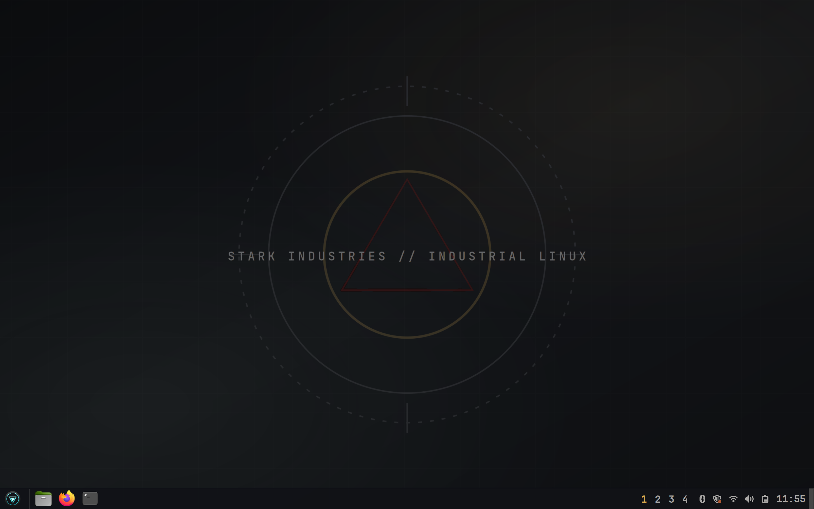
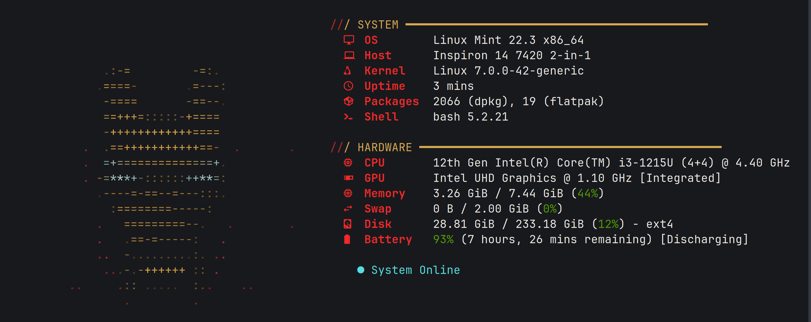
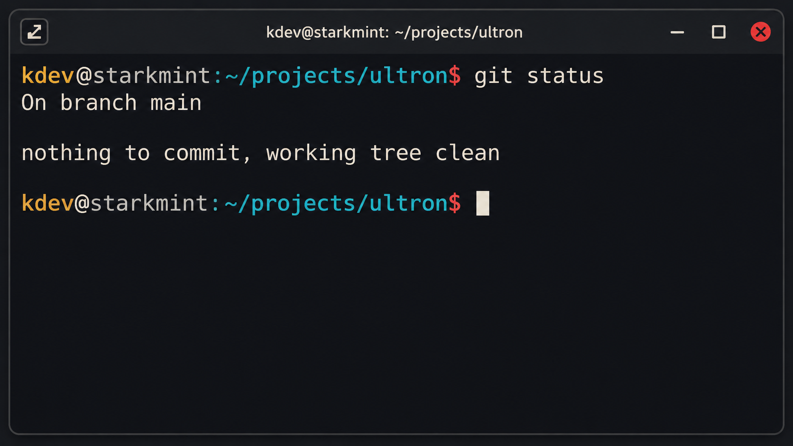

# Stark Mint

**A quiet graphite workspace with purposeful gold and red accents. Industrial in appearance, minimal in everyday use.**

Stark Mint is an open-source desktop theme inspired by the Iron Man Mark III armour and the Stark Industries aesthetic.

It is built on the `Everforest-Green-Dark` variant of [Everforest-GTK-Theme](https://github.com/Fausto-Korpsvart/Everforest-GTK-Theme), which has been modified and extended to create its own visual identity: a dark graphite interface with metallic gold interaction accents and Stark red identity details.

The project targets Linux Mint Cinnamon first, with generic styling for other GTK desktops.

**Current version:** 0.3.0

---

## Contents

- [Design philosophy](#design-philosophy)
- [Preview](#preview)
- [Matching icon theme](#matching-icon-theme)
- [Colour palette](#colour-palette)
- [Typography](#typography)
- [What is implemented](#what-is-implemented)
- [Installation](#installation)
- [Uninstallation](#uninstallation)
- [Manual configuration](#manual-configuration)
- [Project layout](#project-layout)
- [Dependencies](#dependencies)
- [Compatibility and testing](#compatibility-and-testing)
- [Known limitations](#known-limitations)
- [Planned work](#planned-work)
- [Reporting bugs and contributing](#reporting-bugs-and-contributing)
- [Licensing and attribution](#licensing-and-attribution)
- [Disclaimer](#disclaimer)

---

## Design philosophy

Stark Mint uses a deliberately narrow visual system.

- **Graphite** forms the foundation of the interface.
- **Metallic Gold** marks interaction: focus, selection and active states.
- **Stark Red** marks identity, errors and destructive actions.
- **Arc Reactor Cyan** is reserved for occasional, small details in supporting tools such as Fastfetch and the terminal. It is not a third theme accent.

The goal is not simply another dark theme. It is a consistent visual identity that still respects readability, usability and normal desktop conventions.

[DESIGN.md](DESIGN.md) is the full reference for the design rules.

---

### Design reference


The 0.2.0 design reference sheet. It shows the intended Cinnamon panel, menu and file manager layout, GTK control states, notifications, and the full colour and typography system.

This sheet is a design target, not a screenshot of a running desktop. Where it differs from the shipped theme, the shipped theme is the current state of the project.

Screenshots of a real Cinnamon desktop will be added as the project is tested on more systems. See [How to contribute](CONTRIBUTING.md) if you would like to send one.

---

### Cinnamon desktop

Stark Mint running on a real Linux Mint Cinnamon desktop.

The screenshots demonstrate the custom Arc Reactor menu icon,
updated window controls and the overall desktop appearance.



### Fastfetch

Stark Mint includes an optional Fastfetch configuration and logo artwork.

The configuration follows the project's visual identity while displaying dynamic system information.



### Terminal

The terminal has an optional colour configuration and a custom Bash prompt following the Stark Mint palette.

These are manual customisations and are not automatically applied by the theme installer.



## Matching icon theme

[Stark Icons](https://github.com/karthikeyamadhavan123/Stark-Icons) is the
companion icon theme — same palette, same graphite-and-gold direction. It is an
adaptation of Dracula Icons with six signature desktop icons redrawn in the
Stark palette.

```bash
git clone https://github.com/karthikeyamadhavan123/Stark-Icons ~/.icons/Stark-Icons
gtk-update-icon-cache -f ~/.icons/Stark-Icons
```

Then **Themes → Icons → Stark Icons**. Either theme works on its own, but they
are built to be used together.

---

## Colour palette

These values are taken from the theme files themselves.

| Colour        | Hex       | Purpose                                      |
| ------------- | --------- | -------------------------------------------- |
| Forge         | `#0E0F11` | Deepest background: entries, rails           |
| Graphite      | `#18191D` | Main background: views, panels               |
| Surface       | `#1F2126` | Raised surfaces: windows, cards              |
| Charcoal      | `#26282E` | Secondary surfaces: buttons                  |
| Border        | `#343842` | Separators and hairlines                     |
| Silver        | `#A5A9B2` | Secondary text and information               |
| Bone          | `#EBE8E2` | Primary text                                 |
| Metallic Gold | `#D6A84E` | Focus, selection, primary actions, warnings  |
| Stark Red     | `#B3272D` | Identity, errors, destructive actions, close |

### Controlled variations

These are shades of the two accent families. They are not extra accent colours.

| Colour     | Hex       | Use                                                                     |
| ---------- | --------- | ----------------------------------------------------------------------- |
| Light Gold | `#E5BA63` | Hover and raised gold surfaces                                          |
| Deep Gold  | `#C4963F` | Pressed gold, visited links                                             |
| Light Red  | `#E05A60` | Red text on dark backgrounds                                            |
| Error Red  | `#C93037` | Error state colour (`error_color`), close button hover in window frames |
| Deep Red   | `#8E1F24` | Pressed red                                                             |

[COLOUR-REPORT.md](COLOUR-REPORT.md) records the colour audit and the measured contrast ratios.

---

### Supporting micro-accent

| Colour           | Hex       | Use                                                                              |
| ---------------- | --------- | -------------------------------------------------------------------------------- |
| Arc Reactor Cyan | `#55DEE0` | Small reactor-inspired details and special active indicators in supporting tools |

Cyan is not part of the desktop theme's accent system. It is reserved for limited use in Fastfetch and terminal customisation. It must not replace gold for interaction or red for identity and danger.

## Typography

The theme references a single font family, JetBrains Mono, bundled under `fonts/`. Hierarchy comes from weight and size rather than from a second or third family.

| Weight                 | Used for                                                   |
| ---------------------- | ---------------------------------------------------------- |
| JetBrains Mono Regular | General interface text, menus, labels, body copy           |
| JetBrains Mono Medium  | Selected and active labels                                 |
| JetBrains Mono Bold    | Title bars, headings, calendar month and current-day label |

When you let the installer change your desktop settings, it sets the interface font to JetBrains Mono 10, the title bar font to JetBrains Mono Bold 10, and the monospace font to JetBrains Mono 10. You can change these afterwards without breaking the theme.

---

## What is implemented

- GTK 2, GTK 3 and GTK 4 styling.
- Cinnamon desktop styling: panel, menu, notifications, OSD, applets.
- GNOME Shell styling.
- Metacity/Muffin window decorations, in three frame variants.
- Custom triangular Arc Reactor icon for the Cinnamon menu.
- Refined Metacity/Muffin close and maximize/restore button styling.
- Xfwm window decorations, with HiDPI and extra-HiDPI variants.
- A Plank dock theme.
- Bundled JetBrains Mono font.
- An installer and uninstaller with backups.
- A matching wallpaper, distributed separately.

Not every component has been tested on a running desktop. See [Compatibility and testing](#compatibility-and-testing) for the honest status of each.

---

## Installation

### Requirements

- A Linux desktop that can use GTK themes.
- A terminal.
- Bash.
- For GTK 2 applications: the Adwaita and pixmap GTK 2 engines. On Debian and Mint these come from `gnome-themes-extra` and `gtk2-engines-pixbuf`. Without them, GTK 2 applications fall back to a default look. GTK 3, GTK 4 and Cinnamon do not need these.

No root access is needed. Everything is installed under your home directory.

### Method 1 — download a ZIP

1. Download the repository as a ZIP from GitHub.
2. Extract it.
3. Open a terminal in the extracted folder.
4. Run:

```bash
chmod +x install.sh
./install.sh
```

### Method 2 — clone the repository

```bash
git clone https://github.com/karthikeyamadhavan123/stark-mint-theme.git
cd stark-mint-theme
chmod +x install.sh
./install.sh
```

### What the installer does

1. Copies `Stark-Mint`, `Stark-Mint-hdpi` and `Stark-Mint-xhdpi` into `~/.themes`.
2. Installs the bundled fonts into `~/.local/share/fonts/StarkMint`.
3. Copies the wallpaper into `~/Pictures/Stark-Mint`, if you have downloaded it.
4. Asks before changing any desktop setting.

If you say no to step 4, the files are still installed but your current settings are left alone. You can then apply the theme yourself from your desktop's appearance settings.

Nothing is deleted. Anything that would be replaced is first moved into a timestamped backup folder.

### Installer options

| Option           | Description                                                    |
| ---------------- | -------------------------------------------------------------- |
| `--apply`        | Apply the theme, fonts and wallpaper without asking.           |
| `--no-apply`     | Copy files only; never change desktop settings.                |
| `--no-fonts`     | Skip font installation and font settings.                      |
| `--no-wallpaper` | Skip wallpaper installation and settings.                      |
| `--libadwaita`   | Also apply GTK 4 styling through `~/.config/gtk-4.0`.          |
| `--uninstall`    | Uninstall Stark Mint and optionally restore previous settings. |
| `--yes`, `-y`    | Answer yes to questions. Same as `--apply` when installing.    |
| `-h`, `--help`   | Show the built-in help.                                        |

**Note on `--libadwaita`:** this writes into `~/.config/gtk-4.0`, which affects every GTK 4 and libadwaita application, not just one. Existing files there are backed up first.

---

## Uninstallation

Run this from the project folder:

```bash
./install.sh --uninstall
```

The uninstaller:

- Asks whether to restore your previous desktop settings.
- Moves installed files into the backup folder instead of deleting them.
- Restores files that were backed up before installation.

Backups live under:

```text
~/.local/share/stark-mint/
```

To restore only your previous desktop settings:

```bash
bash ~/.local/share/stark-mint/restore-settings.sh
```

Once you are sure you no longer need them, you can delete the backup folder yourself.

---

## Manual configuration

Some touches are controlled by the desktop, not by the theme.

### Cinnamon menu button

Right-click the Menu button, choose Configure, open the Panel section and set its text to `MENU`.

### Cinnamon clock

Right-click the clock, choose Configure, enable a custom date format and use something like:

```text
%a %b %e  %H:%M:%S
```

### GNOME Shell

Enable the User Themes extension before the GNOME Shell theme can be applied.

### Fastfetch

The repository includes a Fastfetch configuration under `fastfetch/`.

It contains:

- `config.jsonc` — Stark Mint Fastfetch configuration.
- `logo.txt` — Custom ASCII logo.

Install Fastfetch separately, then copy the supplied configuration and logo into the appropriate Fastfetch configuration directory.

The configuration is optional and does not affect the desktop theme installation.

### Terminal and Bash

Terminal colours and the Bash prompt are optional manual customisations.

The intended colour assignments are:

| Element            | Colour              |
| ------------------ | ------------------- |
| Background         | Graphite `#18191D`  |
| Default foreground | Bone `#EBE8E2`      |
| Username           | Gold `#D6A84E`      |
| Hostname           | Silver `#A5A9B2`    |
| Working directory  | Cyan `#55DEE0`      |
| Prompt symbol      | Stark Red `#B3272D` |

Configure the terminal background and foreground through your terminal emulator's profile settings.

For the prompt, add this line to the end of `~/.bashrc`:

```bash
PS1='\[\033[38;2;214;168;78m\]\u\[\033[38;2;165;169;178m\]@\h\[\033[0m\]:\[\033[38;2;85;222;224m\]\w\[\033[38;2;179;39;45m\]\$\[\033[0m\] '
```

Then reload with `source ~/.bashrc`, or open a new terminal.

That gives a gold username, silver `@hostname`, cyan working directory and a
Stark red prompt symbol, matching the table above. It uses 24-bit colour
escapes, so the exact hex values come through on any terminal with truecolor
support. Mint's default terminal has it.

To go back to the Mint default, remove the line, or replace it with:

```bash
PS1='\[\033[01;32m\]\u@\h\[\033[00m\]:\[\033[01;34m\]\w\[\033[00m\]\$ '
```

These changes are not installed or modified by the Stark Mint theme installer.

---

## Project layout

| Path                | Contents                                                                      |
| ------------------- | ----------------------------------------------------------------------------- |
| `Stark-Mint/`       | Main theme: GTK 2, GTK 3, GTK 4, Cinnamon, GNOME Shell, Metacity, Xfwm, Plank |
| `Stark-Mint-hdpi/`  | HiDPI Xfwm window decorations                                                 |
| `Stark-Mint-xhdpi/` | Extra-HiDPI Xfwm window decorations                                           |
| `fonts/`            | Bundled JetBrains Mono font and its licence                                   |
| `preview/`          | Screenshots and the design reference sheet                                    |
| `install.sh`        | Installer and uninstaller                                                     |
| `fastfetch/`        | Fastfetch configuration and custom ASCII logo                                 |

---

## Dependencies

### Bundled

Fonts only. JetBrains Mono ships with the theme under the SIL Open Font License 1.1.

### The wallpaper

The Stark Mint wallpaper is distributed **separately from the theme**, as its own download. It is not part of this repository.

This is deliberate. The wallpaper carries Stark Industries branding, and keeping it out of the theme package means the theme itself can be packaged and redistributed without that complication.

The theme does not need the wallpaper. If you have downloaded it, place it at:

```text
wallpaper/stark-mint-wallpaper.png
```

before running the installer, and it will be installed and applied like any other component. If it is not there, the installer skips that step and everything else works normally.

### Referenced but not bundled

`Stark-Mint/index.theme` points at two themes that Stark Mint does **not** ship:

| Theme                | Type         |
| -------------------- | ------------ |
| `Tela-circle-Dark`   | Icon theme   |
| `Everforest-cursors` | Cursor theme |

Install these separately if you want the exact icon and pointer appearance. Without them your desktop falls back to whatever icon and cursor themes you already have. Everything else in Stark Mint still works.

Stark Mint does not yet provide a complete application and file icon theme.

The project includes its own original Arc Reactor Cinnamon menu icon,
but currently relies on an external icon theme for application, folder
and system icons.

Building a complete Stark Mint icon theme is planned future work.
See [CONTRIBUTING.md](CONTRIBUTING.md)

---

## Compatibility and testing

Stark Mint primarily targets Linux Mint Cinnamon.

The table below separates what has been _checked in the files_ from what has been _tested on a running desktop_. Please do not read a checked entry as a tested one.

| Component              | Status                                                                                                            |
| ---------------------- | ----------------------------------------------------------------------------------------------------------------- |
| GTK 2                  | Included; runtime behaviour not yet verified                                                                      |
| GTK 3                  | Loads under the GTK 3.24 parser with no new errors                                                                |
| GTK 4                  | Parser checked; visual testing still needed                                                                       |
| Cinnamon 6.4           | Selectors checked against Cinnamon 6.4.13 source; runtime testing pending                                         |
| Cinnamon 6.6+          | Menu selectors checked against Cinnamon 6.6.4 class names; runtime testing pending                                |
| Cinnamon 6.2 and older | Not verified                                                                                                      |
| GNOME Shell            | Syntax checked; runtime testing pending                                                                           |
| Metacity/Muffin        | XML and referenced assets checked; runtime testing pending                                                        |
| Xfwm                   | Included; runtime testing pending                                                                                 |
| Installer              | Shell syntax and ShellCheck clean; exercised in an isolated user environment, not yet validated on a full desktop |

If you run Stark Mint on a desktop that is not listed as tested, a compatibility report is a genuinely useful contribution. See [CONTRIBUTING.md](CONTRIBUTING.md).

---

## Known limitations

- GTK cannot force every window title into uppercase, so title case varies by application.
- Some Cinnamon window-button settings are controlled by Cinnamon, not by the theme.
- Some CSS properties inherited from upstream are ignored by particular desktop versions.
- GTK 4 and libadwaita applications do not follow third-party themes consistently.
- A complete Stark Mint application and file icon theme is not yet available; an external icon theme is still required.
- Several components still need runtime testing across different desktop environments and versions.

Fixes and detailed notes are in [CHANGELOG.md](CHANGELOG.md).

---

### Flatpak Application Support

Flatpak applications run in a sandbox and may not automatically have access to user-installed GTK themes.

To apply Stark Mint to Flatpak applications:

1. Install and open [Flatseal](https://flathub.org/apps/com.github.tchx84.Flatseal).
2. Select the application you want to customise, or **All Applications**.
3. Under **Filesystem → Other files**, add:

   `~/.themes:ro`

4. Under **Environment → Variables**, add:

   `GTK_THEME=Stark-Mint`

5. Restart the affected application.

> **Note:** Some applications, particularly those using libadwaita, may not
> support complete GTK theme customisation. Appearance can vary between
> applications.

## Planned work

These are intentions, not promises, and not yet implemented:

- A complete Stark Mint application and file icon set.
- Additional Cinnamon menu and applet refinements.
- Runtime testing across more Cinnamon, GNOME and Xfce versions.
- Optional, modular styling for individual applications.
- Further accessibility and contrast work.
- Improvements to the installation and uninstallation process.

---

## Reporting bugs and contributing

Bug reports, compatibility reports, screenshots and code are all welcome.

**To report a bug**, open a GitHub Issue and include your distribution and version, your desktop environment and version, the affected component, what you expected, what happened, and a screenshot if the problem is visual.

**To contribute**, read these first:

- [DESIGN.md](DESIGN.md) — the visual identity and the rules that protect it.
- [CONTRIBUTING.md](CONTRIBUTING.md) — areas open for contribution and the pull request workflow.

Contributions are not limited to bug fixes. Icons, GTK styling, Cinnamon components, window decorations, optional application themes, accessibility and documentation are all open.

**Improve the execution. Preserve the identity.**

---

## Licensing and attribution

Stark Mint is a modified version of Everforest-GTK-Theme (`Everforest-Green-Dark`) by Fausto-Korpsvart, which is licensed under the GNU General Public License version 3.

The root [LICENSE](LICENSE) is the full GPL-3.0 text. It covers the theme files derived from that upstream work, and it also covers Stark Mint's own original files — the installer, the documentation and the preview images — which are released under **GPL-3.0** by choice.

It does **not** automatically cover every file in this repository. Some components keep their own licences:

- `Stark-Mint/gnome-shell/gnome-shell.css` carries a GNU LGPL 2.1 header from GNOME Shell.
- The bundled fonts are under the SIL Open Font License 1.1, with their licence files in `fonts/`.

[CREDITS.md](CREDITS.md) lists every component, its origin and its licence, and marks the items that still need the maintainer to confirm their status.

Please read those notices before you redistribute this theme or any part of it.

---

---

## Some Proofs

Stark Mint and Stark Icons running together on Linux Mint Cinnamon.


---

## Disclaimer

Stark Mint is an independent, community-driven project inspired by the Iron Man visual aesthetic.

It is not affiliated with, endorsed by or sponsored by Marvel, Disney, Linux Mint, the Linux Mint team, or the authors of the upstream theme. "Iron Man", "Stark Industries", "Marvel" and "Linux Mint" belong to their respective owners.
